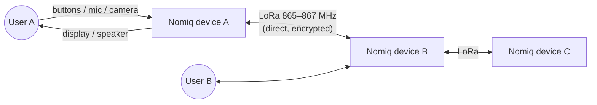
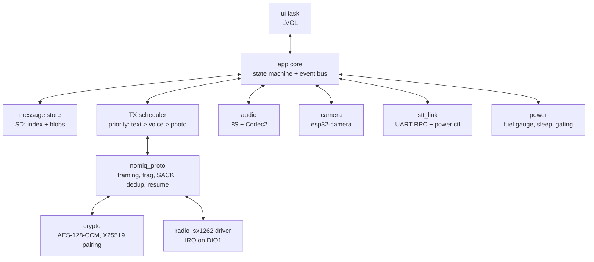
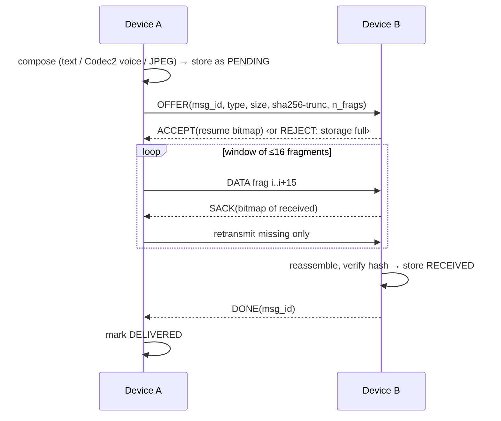

# 01 — System Architecture

## 1. Context



No gateway, no phone, no internet. Each device is an identical peer with a unique 32-bit device ID.

## 2. Hardware blocks

```mermaid
flowchart TB
  subgraph PWR[Power]
    USB[USB-C 5 V] --> CHG[Charger + power-path]
    BAT[1S Li-ion 3000 mAh\n+ protection] <--> CHG
    CHG --> SYS[VSYS 3.4–4.2 V]
    SYS --> BUCK[3V3 buck-boost]
    FG[Fuel gauge] --- BAT
  end
  subgraph MCU[ESP32-S3-WROOM-1 N16R8]
    CORE[Dual LX7 240 MHz\n16 MB flash / 8 MB PSRAM]
  end
  BUCK --> MCU
  CORE -- SPI --> LORA[SX1262 + TCXO\n+ RF switch/LNA path] --> ANT[u.FL / SMA antenna]
  CORE -- DVP 8-bit + SCCB --> CAM[OV2640]
  CORE -- SPI --> LCD[2.4–2.8\" TFT 320×240]
  CORE -- SPI --> SD[microSD]
  CORE -- I²S RX --> MIC[I²S MEMS mic]
  CORE -- I²S TX --> AMP[I²S class-D amp] --> SPK[Speaker]
  CORE -- I²C --> IOX[GPIO expander\nbuttons, resets, enables]
  CORE -- I²C --> FG
  CORE -- UART + EN --> STT[STT co-processor\npower-gated Linux SoM]
  CORE -- USB-Serial-JTAG --> USB
```

## 3. Processor partitioning

| Function | Runs on | Why |
|---|---|---|
| UI, state machine, storage, message queue | ESP32-S3 | Always-on, low power |
| LoRa MAC + Nomiq protocol, crypto | ESP32-S3 | Tight timing, hardware AES |
| Audio capture / playback, Codec2 encode/decode | ESP32-S3 | Codec2 1200 runs comfortably on LX7 |
| Camera capture, JPEG (sensor-side), preview scaling | ESP32-S3 (+ OV2640 JPEG engine) | |
| **Free-form speech-to-text** | **STT co-processor** (power-gated) | ESP-SR MultiNet is limited to ≤200 fixed commands — not dictation. See [ADR-0002](adr/0002-offline-speech-recognition-architecture.md) |

The co-processor is **off by default**. Flow: ESP32 records 16 kHz PCM to SD → powers co-processor → streams PCM over UART (or co-processor reads shared SD file via ESP32 relay) → receives UTF-8 text → powers it off. Standalone requirement is preserved: both chips live on the same PCB.

## 4. Firmware architecture (ESP-IDF, FreeRTOS)



* `nomiq_proto` is **pure C with no ESP-IDF dependency** so it is unit-tested on the host.
* `app_core` is the messenger service (pairing, encrypted link, queue, transfers, history) on top of `nomiq_proto` + `storage`. Its host test runs **three complete simulated devices** over a lossy shared channel: pairing with code comparison, encrypted text, long text, a photo at 20 % loss, sender power-cut + resume, replay/tamper rejection, unpaired-sender isolation, cancel, and history after reboot.
* Run everything with `make test` at the repo root.
* All inter-task communication goes through an event bus (FreeRTOS queues); no shared mutable state across tasks except the SPI bus lock.

## 5. Message lifecycle



Text (≤ 1 fragment) skips OFFER/ACCEPT: single DATA + ACK.

## 6. Key quality attributes

| Attribute | Target | Driver |
|---|---|---|
| Text latency (same room → 1 km) | < 3 s incl. ACK | SF7–SF10 |
| Photo 320×240 @ ~12 kB | < 60 s at SF7, < 3 min at SF9 (no duty limit) | [link budget](specs/lora-link-budget.md) |
| Voice 30 s | < 60 s at SF9 | Codec2 1200 bps |
| Battery life | ≥ 3 days typical use, ≥ 7 days idle-listen | [power budget](specs/power-budget.md) |
| STT | WER ≤ 15 % (English, quiet), latency ≤ 2× audio length | [STT spec](specs/speech-to-text.md) |
