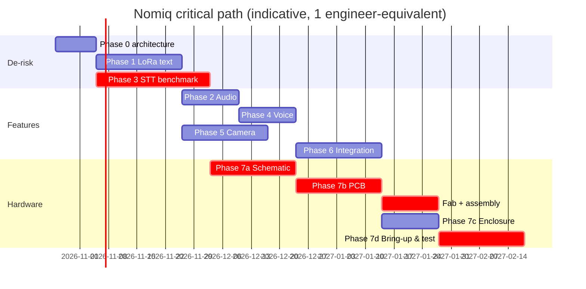

# 03 — Development Roadmap

Each phase ends at a **gate**: a short review where exit criteria are checked and recorded in `tests/reports/`. Agents named are the Claude Code sub-agents in `.claude/agents/`.

| Phase | Goal | Key outputs | Exit gate | Lead agent |
|---|---|---|---|---|
| **0. Architecture** | Freeze requirements, pick dev kits, de-risk | Docs in `docs/`, ADRs 0001–0004, dev-kit BOM | Requirements baselined; dev kits ordered | system-architect |
| **1. LoRa text** | 2× dev boards (ESP32-S3 DevKitC + SX1262 module) exchanging text | `nomiq_proto` v1, `radio_sx1262`, range log | ≥ 99 % delivery @ 500 m LOS with ACK/retry; dedup proven; host tests green | lora-protocol-engineer, firmware-engineer |
| **2. Audio HW** | Mic + amp on dev boards | `audio` component, record/play to SD | 16 kHz capture, SNR ≥ 60 dB, no clipping; playback audible ≥ 75 dB SPL @ 10 cm | audio-speech-engineer |
| **3. Offline STT** ⚠️ | Benchmark engines on candidate co-processors | `docs/specs/speech-to-text.md` results table, ADR-0002 final | WER ≤ 15 %, latency ≤ 2× real-time, energy/utterance measured. **Gates PCB.** | audio-speech-engineer, system-architect |
| **4. Voice messaging** | Codec2 + packetised transfer | voice OFFER/DATA/SACK, resume | 30 s note delivered at SF9 incl. 10 % loss; resume after reboot | lora-protocol-engineer |
| **5. Camera** | OV2640 capture, preview, image transfer | `camera` component, JPEG size control | 320×240 ≤ 12 kB; corrupt fragments detected; image shows on RX | firmware-engineer |
| **6. Integration** | LVGL UI, inbox, power mgmt | Full UI flows (Modes 1–4), message store | All REQ-UI met on dev hardware; idle current measured | firmware-engineer, power-engineer |
| **7a. Schematic** | Custom board schematic | KiCad schematic, BOM v1 | ERC clean; design review checklist signed | electronics-schematic-engineer |
| **7b. PCB** | Layout, fab files | Gerbers, drill, CPL, BOM for JLCPCB | DRC clean; RF review; DFM report | pcb-layout-engineer |
| **7c. Enclosure** | 3D-printed housing from PCB STEP | `mechanical/` STEP/STL | Fit check with PCB STEP; all openings aligned | mechanical-engineer |
| **7d. Bring-up & test** | Assemble 3+ units | Bring-up log, test report | Deliverable #12 test report complete | test-engineer |

## Critical path

STT (Phase 3) runs **in parallel** with Phase 1 because it gates the schematic.

## Phase 0 dev-kit shopping list

| Qty | Item |
|---|---|
| 3 | ESP32-S3-DevKitC-1 N16R8 |
| 3 | SX1262 868 MHz module (e.g. Ebyte E22-900M22S or Waveshare Core1262-HF) + 868 MHz antennas |
| 3 | INMP441 / ICS-43434 I²S mic breakout |
| 3 | MAX98357A I²S amp breakout + 8 Ω 1 W speaker |
| 3 | OV2640 module (24-pin) |
| 3 | 2.4–2.8" SPI TFT (ILI9341/ST7789) with SD slot |
| 2 | STT candidate boards (see speech-to-text spec) |
| 1 | USB power meter + Nordic PPK2 (or similar) for current profiling |

## Branching & workflow

* `main` = always builds; protected. Feature branches `feat/<area>-<topic>`, PR + review.
* Hardware releases tagged `hw-vX.Y`, firmware `fw-vX.Y.Z`, enclosure `mech-vX.Y`.
* Every PR touching `hardware/` must attach ERC/DRC output; every PR touching `nomiq_proto` must keep host tests green (CI).
