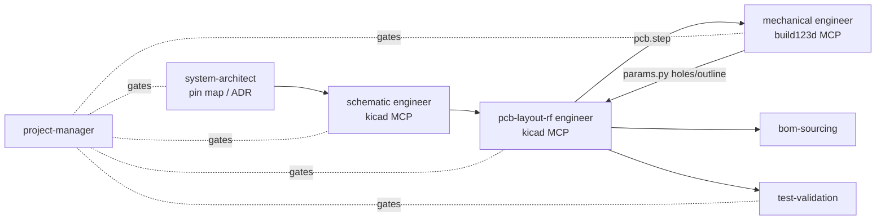

# AI-assisted engineering workflow (Claude Code + MCP)

## 1. Why these MCP servers

| Need | Server | Why chosen | Alternatives evaluated |
|---|---|---|---|
| KiCad schematic + PCB | **[kicad-mcp-pro](https://github.com/oaslananka/kicad-mcp-pro)** (MIT) | Most complete & actively maintained (v4.x): schematic/PCB inspection, ERC/DRC, DFM, BOM, manufacturing export; profile-based tool sets (read-only `default` → `build`/`release`) with human-gated release; KiCad 10 IPC support; runs via `uvx` | [Seeed-Studio/kicad-mcp-server](https://github.com/Seeed-Studio/kicad-mcp-server) (strong pin-level net tracing — good second opinion for reviews), [mcp-server-kicad](https://github.com/ProductOfAmerica/mcp-server-kicad) (now maintenance-only), [mixelpixx/KiCAD-MCP-Server](https://mcpservers.org/servers/mixelpixx/kicad-mcp-server) |
| Enclosure CAD (primary) | **[build123d-mcp](https://github.com/pzfreo/build123d-mcp)** (Apache-2.0) | CAD-as-code fits git review; persistent session, PNG/SVG renders, measure, printability & fit checks, STEP/STL export, STEP import for PCB fit checks | [mcp-build123d](https://github.com/superWorldSavior/mcp-build123d) |
| Enclosure CAD (interactive / FEM) | **[freecad-mcp](https://github.com/neka-nat/freecad-mcp)** (MIT, most widely used) | GUI inspection, assemblies, FEM | [freecad-addon-robust-mcp-server](https://github.com/spkane/freecad-addon-robust-mcp-server), [blwfish/freecad-mcp](https://github.com/blwfish/freecad-mcp) |

These are **local** MCP servers: they run on the engineer's computer next to KiCad / FreeCAD, not in the cloud.

## 2. One-time setup (your computer)

```bash
# prerequisites
#  - KiCad 9 or 10 (kicad-cli on PATH)
#  - uv  (https://docs.astral.sh/uv/)  -> provides uv / uvx
#  - Claude Code CLI or Claude desktop app
git clone https://github.com/anand2532/Nomiq.git && cd Nomiq

uvx kicad-mcp-pro --help                                  # fetch + smoke test
uv tool run --python 3.12 build123d-mcp@latest --version  # fetch + smoke test
```

Optional FreeCAD: copy `addon/FreeCADMCP` from the freecad-mcp repo into FreeCAD's `Mod/` folder, restart FreeCAD, pick the *MCP Addon* workbench and click **Start RPC Server**.

Start Claude Code in the repo root; approve the project MCP servers when prompted (or run `claude mcp list` to check). The kicad server starts in its read-only profile — switch to the `build` profile (see its README / `.env.example`, `KICAD_MCP_*` variables) only when you want Claude to edit the design.

## 3. Using the engineer agents

Agents live in `.claude/agents/`. Ask for one explicitly or let Claude delegate:

```
> Use the electronics-schematic-engineer to capture the 03_radio sheet from the Semtech reference design.
> Have the lora-protocol-engineer add resumable OFFER/ACCEPT handling and tests.
> /phase-gate 1
> /airtime 12000 sf9
> /hw-check
> /enclosure
```

Typical cross-discipline loop for the custom board:



## 4. Guardrails
- Agents propose; humans approve fabrication orders, part purchases and regulatory decisions.
- Keep the kicad server in a read-only profile for reviews; use edit profiles on a feature branch only.
- Every AI-made hardware change goes through a PR with ERC/DRC output attached.
