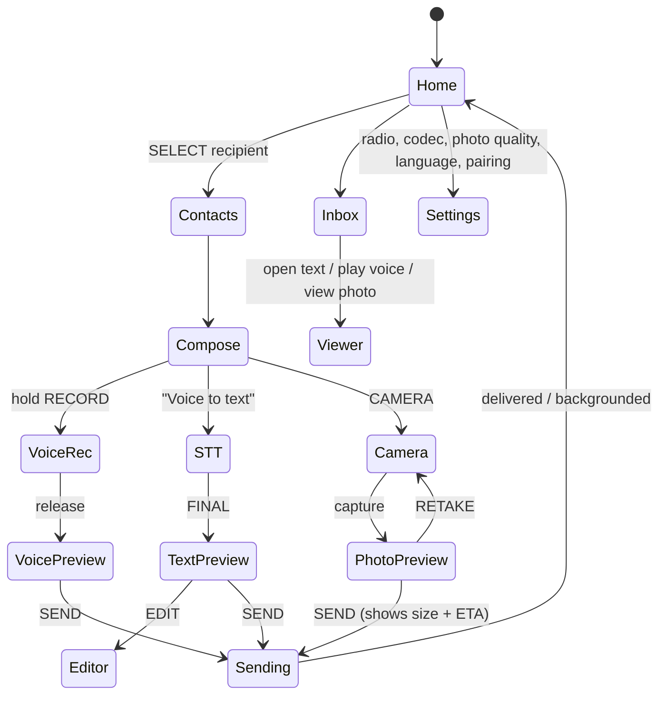

# UI Flows & Local Storage

## 1. Controls

| Control | Short press | Long press |
|---|---|---|
| UP / DOWN | Move selection | Page scroll |
| SELECT | Confirm | Context menu |
| BACK | Back | Home |
| RECORD (side) | — | Hold-to-record (PTT) |
| CAMERA (side) | Open camera / capture | — |
| POWER | Screen on/off | 3 s: power off (ship mode) |

## 2. Screen map



Status bar on every screen: own ID, selected peer, RSSI/SNR bars, battery %, charging icon, active-transfer mini-progress.

**Long-transfer UX (REQ-UI-004):** before sending voice/photo show "≈ 1 min 15 s at current signal". During: % complete, ETA, retries, "Pause / Cancel / Run in background". Duty-cycle profile waits are shown as "Waiting for radio quota — 3 min".

## 3. Storage layout (microSD, FAT32)

```
/sd/nomiq/
  index.log            append-only record log (msg_rec_t) + periodic compaction
  out/<peer>/<msg_id>.{txt,c2,jpg}
  in/<peer>/<msg_id>.{txt,c2,jpg}
  partial/<peer>_<sha8>.{bin,bmp}   in-progress receives (data + bitmap) — resumable
  pcm/tmp.pcm          raw recording scratch (deleted after encode/STT)
  contacts.json        paired peers: id, name, pubkey fingerprint
```

Keys are **not** on SD — they live in encrypted NVS.

**Storage-full (REQ-STO-004):** below 5 % free → warn; below 1 % → REJECT incoming bulk objects (reason STORAGE_FULL), still accept text; offer "delete oldest media".
**Persistence (REQ-STO-003):** every state change appended to `index.log` with fsync before radio action; on boot, PENDING/SENDING → PENDING and resume.
